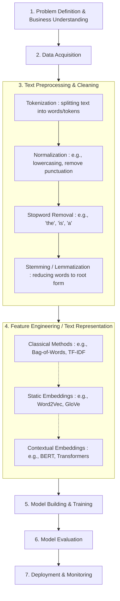

# NLP Pipelines

**Session Time:** 120 minutes

---

## Table of Contents

1. The Anatomy of an NLP Pipeline
2. The Hugging Face `pipeline` Abstraction
3. Framework for Selecting Pre-Trained Models
4. Lab: Plug-and-Play Benchmarking
5. Wrap-Up and Reflection
6. Resources

---

## Learning Objectives

By the end of this module, participants will be able to:

1. **Deconstruct** a typical NLP pipeline into its core components: Tokenization, Model Inference, and Post-Processing.
2. **Utilize** the Hugging Face `pipeline()` API for rapid prototyping across various tasks (Sentiment, NER, Summarization).
3. **Apply** a structured framework to select the most appropriate pre-trained model from the Hugging Face Hub based on constraints (size, license, domain).
4. **Construct** a comparative benchmark for multiple sentiment analysis models, evaluating them on both accuracy and inference speed.

---

## Session Breakdown

| Segment | Topic | Duration (minutes) |
| :--- | :--- | :--- |
| 1 | The Anatomy of an NLP Pipeline (Under the Hood) | 20 |
| 2 | The Hugging Face `pipeline` Abstraction | 20 |
| 3 | Framework for Selecting Pre-Trained Models | 20 |
| 4 | Lab: Plug-and-Play Benchmarking (DistilBERT vs. RoBERTa) | 45 |
| 5 | Wrap-Up and Reflection | 15 |

---

## 1. The Anatomy of an NLP Pipeline (20 min)

### NLP General Workflow 



* **Beyond "Magic":** In the previous module, we manually vectorized text (TF-IDF/embeddings) and fed it to a classifier. Modern NLP models (Transformers) require a more complex, standardized sequence of steps.
* **The Three Stages:**
    1.  **Preprocessing (Tokenization):** Converting raw strings into model-readable integer IDs. This *must* match the specific vocabulary the model was trained on.
        * *Crucial detail:* Handling special tokens (`[CLS]`, `[SEP]`), padding, and truncation.
    2.  **Model Inference:** The forward pass through the neural network (the Transformer) to get raw "logits" (unnormalized scores).
    3.  **Post-Processing:** Converting logits into human-readable outputs (e.g., running specific softmax functions, mapping ID `label_0` to "NEGATIVE").

## 2. The Hugging Face `pipeline` Abstraction (20 min)

* **The Easy Button:** Introduction to `transformers.pipeline()`.
* **What it automates:** It handles all three stages above in a single function call.
* **Key Tasks Supported:**
    * `sentiment-analysis` (Text Classification)
    * `ner` (Named Entity Recognition - Token Classification)
    * `question-answering` (Extractive)
    * `summarization` (Seq2Seq)
* **Peeking Under the Hood:**
    * Show students that `pipeline("sentiment-analysis")` is actually just a wrapper around:
        ```python
        from transformers import AutoTokenizer, AutoModelForSequenceClassification
        # Pipeline does this for you:
        tokenizer = AutoTokenizer.from_pretrained("distilbert-base...")
        model = AutoModelForSequenceClassification.from_pretrained("distilbert-base...")
        ```

## 3. Framework for Selecting Pre-Trained Models (20 min)

With over 500,000+ models on the Hugging Face Hub, how do you choose?

* **The Selection Framework:**
    1.  **Task Compatibility:** Does the model architecture match your goal? (Don't use a GPT-style decoder for standard classification if a BERT-style encoder is 10x faster and better).
    2.  **Domain Specificity:** Was it trained on relevant data? (e.g., `finbert` for financial text vs. generic `roberta`).
    3.  **Performance Metrics:** Checking the "Model Card" for reported metrics (Accuracy, F1, GLUE score) on standard benchmarks.
    4.  **Size & Latency Constraints:**
        * *DistilBERT* (~66M params) vs *BERT-Large* (~340M params).
        * Do you need real-time CPU inference (go small) or offline batch GPU processing (go large)?
    5.  **License:** Apache 2.0 / MIT (commercial friendly) vs. Llama community licenses (restrictive).

## 4. Lab: Plug-and-Play Benchmarking (45 min)

**Objective:** Construct a reusable benchmarking pipeline that takes *any* list of text inputs and compares varying pre-trained models on speed and output.

**Dataset:** Use a challenging small set of custom "tricky" reviews:
* *Sarcasm:* "Great, my battery lasted a whole 20 minutes."
* *Mixed:* "The acting was superb, but the script was absolute trash."

**Steps:**
1.  **Baseline (Default):** Initialize `pipeline("sentiment-analysis")`. This usually defaults to a generic DistilBERT model. Run it on the data.
2.  **Challenger 1 (RoBERTa for Social Media):**
    * Initialize a specific pipeline: `pipeline("sentiment-analysis", model="cardiffnlp/twitter-roberta-base-sentiment-latest")`.
    * *Hypothesis:* This should handle slang, emojis, and sarcasm better than the baseline.
3.  **Challenger 2 (Domain Specific - Optional):** try a finance or multilingual model if relevant to student interests.
4.  **Benchmarking Loop:**
    * Create a function that takes a `pipeline` object and a list of texts.
    * Use Python's `time.perf_counter()` to measure exactly how long the `.__call__()` takes for the whole batch.
    * Store results in a Pandas DataFrame for side-by-side comparison of predictions and confidence scores.

**Expected Outcome:** Students should see that generic models often fail on sarcasm (labeling "Great, my battery..." as POSITIVE due to the word "Great"), while domain-adapted models (like Twitter-RoBERTa) might catch it.

## 5. Wrap-Up and Reflection (15 min)

**Discussion Questions:**
1.  Why might we *not* want to use the high-level `pipeline()` API in a production system where we need to process 10 million tweets a day? (Hint: Batching efficiency and stripping away unnecessary overhead).
2.  If you needed to analyze medical records for patient sentiment, why would standard BERT likely fail? What would you look for on the Hub?
3.  What happened when you fed the mixed review ("acting superb, script trash") to the models? How do standard sentiment models struggle with *aspect-based* sentiment?

---

## 6. Resources

* [Hugging Face Hub (Model Search)](https://huggingface.co/models)
* [Transformers Pipeline Official Docs](https://huggingface.co/docs/transformers/main_classes/pipelines)
* [Papers with Code (SOTA benchmarks)](https://paperswithcode.com/sota)